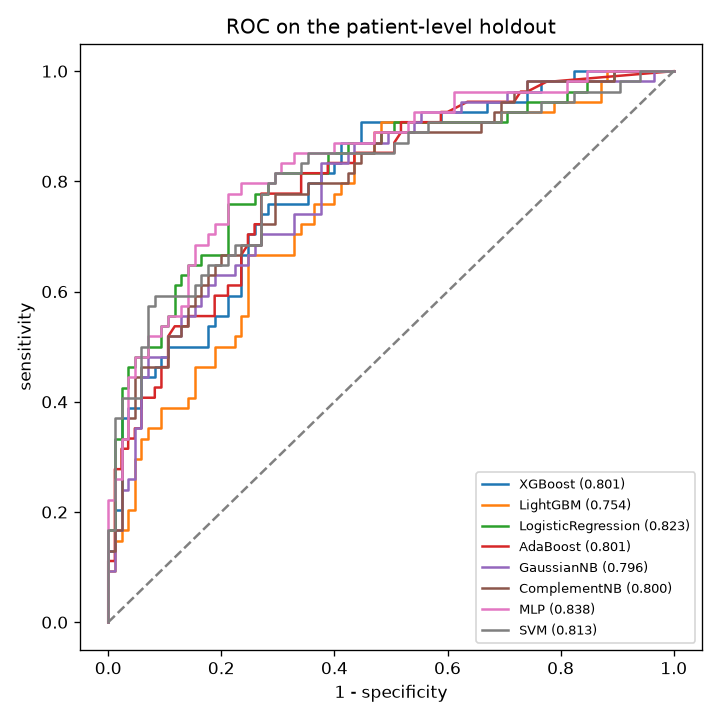
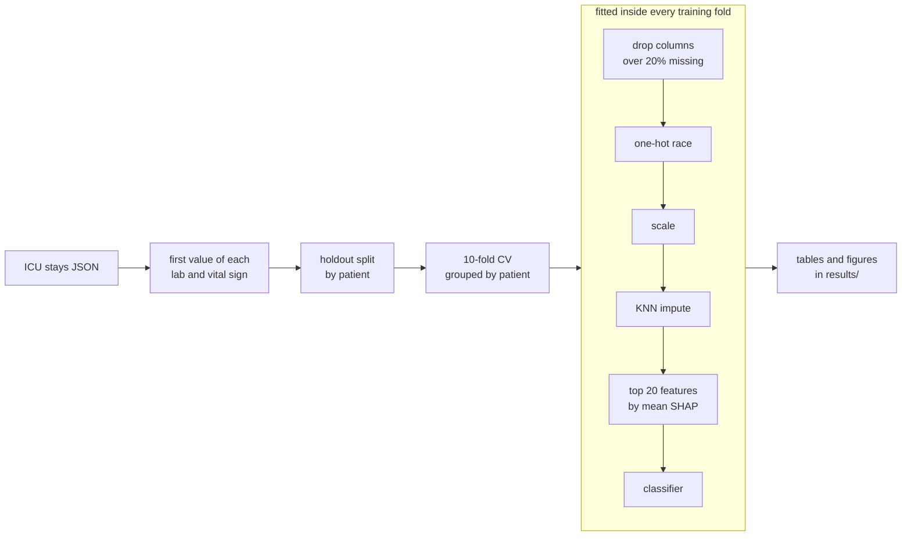

# AKIRiskPredictor

[](https://github.com/doanan293/AKIRiskPredictor/actions/workflows/ci.yml)

Predicts acute kidney injury (AKI) within seven days of ICU admission for adults with diabetic ketoacidosis, from first-day MIMIC-IV data, and compares eight classifiers under patient-level validation.

## Results

The cohort has 970 labelled ICU stays from 714 patients, 38.9 % with AKI. A holdout of 139 stays was split off by patient, so no patient appears in both training and evaluation. Every model was tuned with Optuna's quick budget and cross-validated on the training split before a single scoring pass on the holdout ([results/holdout.md](results/holdout.md)):

| model              | AUC (95% CI)        |    f1 |   sensitivity |   specificity |
|:-------------------|:--------------------|------:|--------------:|--------------:|
| MLP                | 0.838 (0.768-0.901) | 0.714 |         0.833 |         0.682 |
| LogisticRegression | 0.823 (0.751-0.890) | 0.703 |         0.722 |         0.788 |
| SVM                | 0.813 (0.736-0.880) | 0.654 |         0.648 |         0.788 |
| AdaBoost           | 0.801 (0.728-0.868) | 0.673 |         0.704 |         0.753 |
| XGBoost            | 0.801 (0.728-0.871) | 0.588 |         0.556 |         0.788 |
| ComplementNB       | 0.800 (0.723-0.869) | 0.672 |         0.778 |         0.659 |
| GaussianNB         | 0.796 (0.722-0.868) | 0.649 |         0.685 |         0.729 |
| LightGBM           | 0.754 (0.677-0.834) | 0.54  |         0.5   |         0.776 |

All confidence intervals overlap, so the holdout alone cannot rank the models. In 10-fold patient-grouped cross-validation ([results/cv.md](results/cv.md)) SVM (0.805) and logistic regression (0.800) lead, and the MLP is sixth (0.775). Logistic regression is near the top in both and is the simplest to explain, so it is the default model for `aki predict`.



Also generated: [baseline characteristics](results/table_1.md), [feature ranking](results/selected_features.md), [tuned hyperparameters](results/tuned_params.json), [calibration](results/calibration_holdout.png) and [decision curves](results/decision_curve_holdout.png).

### Compared with the earlier version

An earlier version of this project reported a holdout AUC of 0.859 for TabPFN and 0.839 for logistic regression. Those numbers came from a split by ICU stay, which let stays of the same patient land on both sides, and from imputation, feature selection and tuning fitted on all training data before cross-validation. This version fixes both, so its numbers are lower and more honest. TabPFN is not in the table because its checkpoint is not available on the machine that produced these results. It can be added with `uv sync --extra tabpfn`.

## How it works



- `data.py` reduces each stay to one row: the earliest value of every lab and vital sign, severity scores, eGFR, comorbidity flags (absent means no), gender, liver disease grade and race.
- `validation.py` splits by patient with `StratifiedGroupKFold` and computes bootstrap confidence intervals.
- `pipeline.py` is a scikit-learn `Pipeline`, so dropping sparse columns, imputation, scaling and SHAP feature selection are refitted on each training fold and never see validation rows. A test checks that a feature leaking the label only in validation rows is never selected.
- `models.py` holds the classifiers, `tuning.py` the Optuna search spaces, and `reporting.py` the tables and plots. Counts below 11 are suppressed in Table 1, following the PhysioNet small-cell rule.

## Quickstart

The repository ships a synthetic cohort, so everything runs without access to MIMIC-IV:

```bash
uv sync
uv run aki report          # tune, train and evaluate on data/sample, write results/
uv run aki predict         # one probability per stay in data/sample/test.json
```

Running `report` on the sample overwrites `results/` with numbers from synthetic data, which mean nothing clinically. Use `git checkout results` to get the real results back.

Each step also has its own command: `aki prepare`, `aki select-features`, `aki tune`, `aki train`, `aki evaluate`, `aki predict` and `aki synthesize`. Settings live in [configs/default.yaml](configs/default.yaml).

## Data

The real cohort comes from [MIMIC-IV](https://physionet.org/content/mimiciv/). Access needs PhysioNet credentialing and a signed data use agreement, which forbids sharing the data, so it is not in this repository and never was in its history. With access, put the extracted `train.json` and `test.json` in `local-data/` (ignored by git) and the CLI picks them up automatically. Only aggregate tables and figures are committed under `results/`. See [data/README.md](data/README.md) for the schema and the synthetic generator.

## Limitations

- One hospital system and 139 holdout stays, so the intervals are wide and there is no external validation.
- Only the first value of each measurement is used. Trends over the first day are ignored.
- The quick tuning budget runs one to three Optuna trials per model. A larger search may change the ranking.
- This is a research project. It is not a validated clinical tool.

## Development

```bash
uv run ruff check && uv run ruff format --check && uv run pyrefly check && uv run pytest
```

## License

MIT, see [LICENSE](LICENSE). MIMIC-IV data is subject to the PhysioNet credentialed health data license and is not covered by this license.
